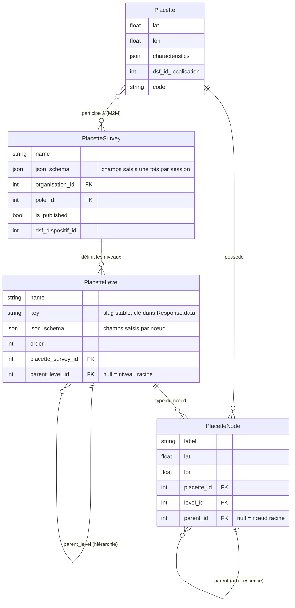

# Modèles placettes

## Diagramme

*Dernière mise à jour le 5 novembre 2026*



## Rôle de chaque modèle

### PlacetteSurvey — l'enquête (protocole)

Un `PlacetteSurvey` représente une enquête placette (équivalent au *dispositif* ou *campagne* DSF). Il appartient à une organisation et éventuellement un pôle, et peut être publié ou non. Son `json_schema` racine contient les champs saisis une seule fois par session (date, opérateur, etc.), avant tout relevé hiérarchique.

Une même instance de PlacetteSurvey peut regrouper de nombreuses placettes. Plusieurs enquêtes peuvent partager une même placette (relation M2M).

### PlacetteLevel — les niveaux hiérarchiques

Les `PlacetteLevel` définissent la structure de saisie d'un protocole, par exemple arbre > branche > échantillon, etc. Ils forment un arbre via `parent_level` (`null` pour le niveau racine). Chaque niveau porte un `json_schema` avec les champs à saisir pour chaque nœud de ce niveau, ainsi qu'une `key` (slug stable) utilisée comme clé dans `Response.data`.

### Placette — le point géographique

Une `Placette` est un point physique sur le terrain, identifié par ses coordonnées. Elle est liée en M2M aux protocoles auxquels elle participe. On s'attend à environ 3,5 % des placettes qui feront partie de plusieurs protocoles (au moins pour le DSF), d'où la relation M2M plutôt qu'une FK.

### PlacetteNode — les instances de terrain

Un `PlacetteNode` est une instance nommée dans la hiérarchie d'une placette : un arbre particulier, une branche particulière, etc. Il relie une `Placette` à un `PlacetteLevel`, et peut avoir un nœud parent (`null` pour les nœuds racines). L'arborescence des nœuds doit être cohérente avec la hiérarchie des niveaux (validée par `PlacetteNode.clean()`).

## Flux de saisie

Lors d'une session de terrain, une `Response` est créée avec :
- une `Placette` et un `PlacetteSurvey` liés,
- un `placette_schema_snapshot` figé au moment de la création (image du schéma au format `response_data_schema`),
- un champ `data` structuré selon ce schéma : champs racines puis, pour chaque niveau, un tableau de nœuds identifiés par leur `node_id`.

```json
{
  "date": "2026-05-12",
  "operateur": "Dupont",
  "arbre": [
    {
      "node_id": "42",
      "essence": "chêne",
      "branche": [
        { "node_id": "101", "longueur": 3.5 }
      ]
    }
  ]
}
```
